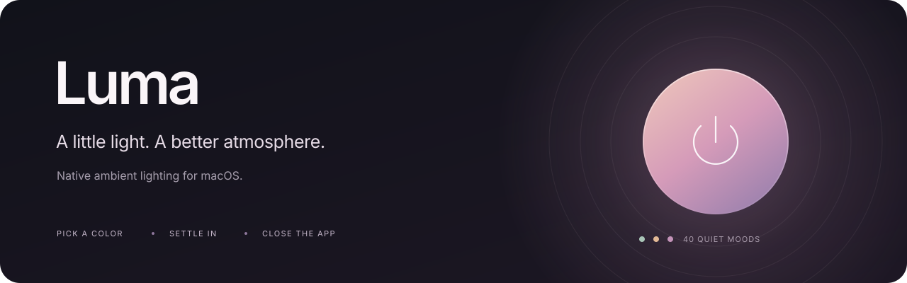
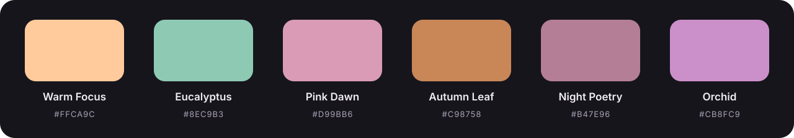

<p align="center">
  
</p>

<p align="center">
  <strong>A color for this moment. An atmosphere of your own. Nothing left running when you quit.</strong>
</p>

<p align="center">
  macOS 13+ · English / Русский · 40 presets · No third-party packages · MIT
</p>

<p align="center">
  <a href="https://github.com/haos001/Luma/releases/download/v0.5.0/Luma-0.5.0-macOS-arm64.zip"><strong>Download for Apple Silicon</strong></a> ·
  <a href="https://github.com/haos001/Luma/releases">All releases</a> ·
  <a href="README.ru.md">Русский</a> ·
  <a href="#installation">Install</a> ·
  <a href="#a-color-for-this-moment">Recommended now</a> ·
  <a href="#use-the-app">How it works</a> ·
  <a href="docs/HARDWARE.md">Hardware & protocol</a> ·
  <a href="CONTRIBUTING.md">Contributing</a>
</p>

## Set the mood. Close the app.

Luma is a small desktop app for a specific ROBOBLOQ USB monitor-backlight controller. Pick a color, let it settle in, and quit. The tested controller keeps its static color without a companion service.

No Electron, account, cloud connection, or always-on helper. Just a native interface and direct USB HID commands.

> **Compatibility first:** this is not a universal RGB controller. The tested device uses USB `1A86:FE07`, vendor usage page `0xFF00`, and a 96-LED strip. Matching USB IDs alone do not guarantee the same firmware. [Check the hardware notes](docs/HARDWARE.md) before sending commands.

## A color for this moment

Morning coffee. A focused afternoon. A slow autumn evening. Your desk can have a different atmosphere for each.

**Recommended now** gives you a thoughtful starting point instead of an empty color picker. Luma considers your **local time, season, and weekday or weekend**, then suggests a color from its curated palette. Warm apricot for an autumn morning, fresh eucalyptus for a spring workday, or a dusty rose for a late-night session.

| Your moment | A taste of the palette |
| --- | --- |
| An autumn morning | Apricot Morning · Vanilla Light |
| A spring workday | Eucalyptus |
| An autumn evening | Amber Study · Copper Sunset |
| A spring night | Night Poetry · Quiet Lilac |
| A winter weekend morning | Slow Latte |

These are examples of eligible presets, not a fixed schedule. The date helps vary the suggestion when several equally suitable colors are available.

Select the recommendation, click the glowing circle, and let the old color fade into the new one. Or follow your own taste: every preset, brightness control, and custom color remains yours to choose.

> **Less time choosing. More atmosphere for whatever comes next.**

<details>
<summary>Thoughtful suggestions, without tracking or a background service</summary>

Recommendations are calculated on your Mac using its local calendar and Northern Hemisphere seasons. Work presets get priority during weekday daytime; rest presets get priority on weekends when available; nighttime favors the night palette. The suggestion stays consistent for the same date and time period.

Luma refreshes the recommendation when you open or return to the app, or use Refresh. It suggests a color; it does not change your light on a timer. No AI service, weather feed, location access, or personal calendar data is involved.

</details>

## A small app with the right controls

<p align="center">
  
</p>

- **40 curated presets** across work, morning, evening, night, seasons, rest, creativity, and cinema.
- **Recommended now** — a considered color for the time, season, and rhythm of your day, calculated entirely on your Mac.
- **Your exact color** — an HSV square, hue strip, RGB sliders, HEX entry, brightness, and saved favorites.
- **A gentle transition** — a visible color wave, then a fade to black and a smooth fade into the selected color.
- **At home on macOS** — native navigation, automatic light/dark appearance, and Liquid Glass controls on macOS 26+.
- **A tiny command-line companion** — `lumactl` for scripts and manual control.

### Two languages, one familiar app

**English and Russian are built in.** Interface labels, all 40 preset names and descriptions, recommendations, tooltips, and device errors follow your chosen language. Open **… → Language / Язык** and choose **English**, **Русский**, or **Follow macOS**. Changes appear immediately, without restarting; Luma remembers your choice.

On first launch, Luma follows the first supported language in your macOS language list, falling back to English. Your own favorite names stay exactly as you wrote them. Search understands built-in preset names in either language. Changing language does not send a command to the backlight.

## Installation

### Download the app

Get **Luma 0.5.0** from [GitHub Releases](https://github.com/haos001/Luma/releases/tag/v0.5.0), including the ready-to-run app and its SHA-256 checksum. You do not need Xcode, Swift, or a package manager to use a downloaded build.

1. [Download Luma for Apple Silicon](https://github.com/haos001/Luma/releases/download/v0.5.0/Luma-0.5.0-macOS-arm64.zip).
2. Unzip it and drag **Luma.app** into **Applications**.
3. Quit any other app controlling the backlight, then open Luma.

The archive also includes the optional `lumactl` command, the MIT license, and installation notes in English and Russian. No installer, administrator password, login item, or background service is added.

> **Before installing:** the current build is ad-hoc signed, **not notarized by Apple**. macOS may block a downloaded copy. Review the source and the [installation and signing notes](docs/INSTALL.md); do not disable Gatekeeper globally. An Intel build is not included in the initial release.

### Build from source

| | Requirement |
| --- | --- |
| Run | macOS 13 or later; a compatible USB controller |
| Build | Xcode 26+ or corresponding Command Line Tools, macOS SDK 26+, Swift 6.2+ |
| Ready-to-run build | Apple Silicon (`arm64`); Intel is not yet validated |
| Dependencies | Apple frameworks only; no external Swift packages |

Runtime availability checks keep the app compatible with older macOS versions, but compiling Liquid Glass APIs requires a recent SDK. The macOS 13 deployment target is not a claim that every older system has been tested.

Clone [haos001/Luma](https://github.com/haos001/Luma), then build it:

```sh
git clone https://github.com/haos001/Luma.git
cd Luma
bash scripts/test.sh
bash scripts/build.sh
open dist/Luma.app
```

Drag `dist/Luma.app` into Applications when you are happy with the build. The scripts do not install anything automatically.

<details>
<summary>Explore the interface without a light connected</summary>

After building from source:

```sh
open dist/Luma.app --args --preview
# Optional appearance overrides, only in preview mode:
open dist/Luma.app --args --preview --light
open dist/Luma.app --args --preview --dark
```

Quit any running Luma instance before changing launch arguments. Preview mode disables USB operations and uses separate temporary preferences.

</details>

## Use the app

1. Pick a preset or create a color in **Свой цвет** (Custom color).
2. Click the glowing circle, **Включить** (Turn on), or press **⌘ Return**.
3. Quit when the transition finishes. The controller keeps the static light while powered.

Click the recommendation title to select it; the circle always applies the **currently selected** color. Brightness stays visible in the bottom bar. The `…` menu contains live preview and refresh; the menu beside Turn on contains **Включить и закрыть** (Turn on and quit).

Opening or closing Luma does not automatically send an off command. Continuous effects, screen mirroring, and scheduled changes are intentionally outside this version.

## Command line

```sh
# Read-only / no color changes
./dist/lumactl status
./dist/lumactl recommend
./dist/lumactl dry-run '#C98758' 100

# These commands change the physical light immediately
./dist/lumactl color '#C98758' 100
./dist/lumactl off
```

The CLI sends a single static command; it does not play the app's wave or fade animation. Avoid concurrent controllers. USB success means a report was sent, not that the strip's physical color was read back.

## Local by design

Luma has no analytics, network client, automatic updates, account system, or background agent. Preferences live in `~/Library/Application Support/Luma/state.json`. They are never included in this repository.

The recommendation uses the Mac's local calendar and Northern Hemisphere seasons. It does not fetch weather, location, or calendar events. Color names express a mood, not a medical or productivity guarantee.

Read [privacy details](docs/PRIVACY.md) and [known limitations](docs/HARDWARE.md#limitations).

## Development

The 17 core test scenarios run without attached hardware and without XCTest. They cover color conversion, packet generation, recommendations, saved state, transition logic, translation coverage, and language migration—not physical light output or end-to-end UI behavior.

```sh
bash scripts/test.sh
bash scripts/build.sh
bash scripts/package-release.sh
```

The packaging script creates an architecture-labelled ZIP and SHA-256 checksum in `dist/releases/`. Local builds are ad-hoc signed, **not notarized**. See [installation](docs/INSTALL.md) and the [release checklist](docs/RELEASING.md).

| Area | Responsibility |
| --- | --- |
| `Sources/LightCore` | Color math, presets, recommendations, persistence, USB, transition frames |
| `Sources/LumaApp` | SwiftUI interface and application state |
| `Sources/LightCLI` | `lumactl` entry point |
| `Tests/LightCoreTests` | Hardware-free executable test harness |
| `scripts` | Build, icon generation, checks, and release packaging |

[Architecture](docs/ARCHITECTURE.md) · [Contributing](CONTRIBUTING.md) · [Changelog](CHANGELOG.md) · [Security](SECURITY.md)

## Questions

<details>
<summary>Does Luma need to stay open?</summary>

No. After the transition finishes, the tested controller keeps its static color while powered. Luma installs no helper process. Unplugging the controller may reset its state.

</details>

<details>
<summary>Will it work with any RGB strip?</summary>

No. The initial release targets one tested USB HID controller. Check [hardware compatibility](docs/HARDWARE.md) before applying colors. Reports about other firmware revisions are welcome, but matching USB IDs are not proof of compatibility.

</details>

<details>
<summary>Can it mirror my screen or animate continuously?</summary>

Not in this version. Luma focuses on static colors with a smooth transition. Continuous effects and screen capture would require a running process and additional resource use.

</details>

## License & independence

[MIT](LICENSE). Copyright © 2026 Luma contributors.

Luma is an independent project, not affiliated with or endorsed by ROBOBLOQ, SyncLight, or Apple. Vendor names identify hardware and platforms. No vendor application binary, firmware, or extracted vendor asset is distributed here.
