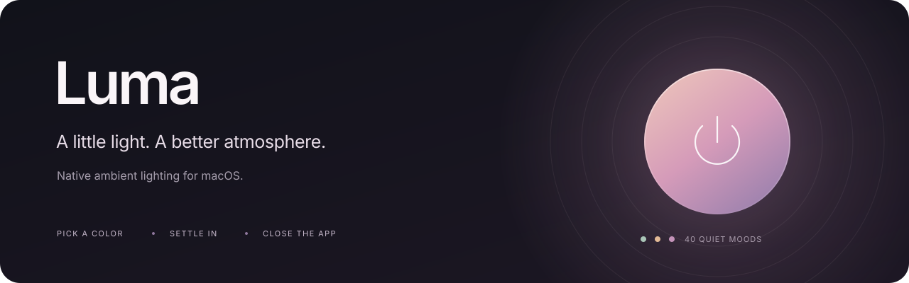
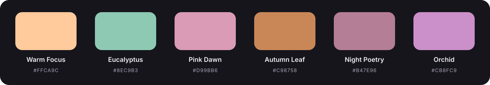

<p align="center">
  
</p>

<p align="center"><strong>Цвет под ваш момент. Атмосфера под ваше настроение. Без работы в фоне после выхода.</strong></p>
<p align="center">macOS 13+ · SwiftUI + IOKit · 40 пресетов · Без сторонних пакетов · MIT</p>
<p align="center"><a href="https://github.com/haos001/Luma/releases/download/v0.4.0/Luma-0.4.0-macOS-arm64.zip"><strong>Скачать для Apple Silicon</strong></a> · <a href="https://github.com/haos001/Luma/releases">Все релизы</a> · <a href="README.md">English</a> · <a href="#установка">Установка</a> · <a href="#цвет-под-ваш-момент">Рекомендуется сейчас</a> · <a href="docs/HARDWARE.md">Совместимость</a></p>

## Свет для вашего ритма

Luma — небольшое нативное приложение для конкретного USB-контроллера мониторной подсветки ROBOBLOQ. Выберите оттенок, дождитесь плавного перехода и закройте приложение. Проверенный контроллер сохраняет статичный цвет, пока получает питание.

Без Electron, облака, учётной записи и постоянно работающей фоновой службы.

> **Важно:** Luma не является универсальным контроллером RGB. Проверено устройство с USB `1A86:FE07`, usage page `0xFF00` и лентой на 96 светодиодов. Даже совпадение USB ID не гарантирует одинаковую прошивку. Перед отправкой команд прочитайте [описание совместимости](docs/HARDWARE.md).

## Цвет под ваш момент

Утренний кофе. Работа, в которую хочется погрузиться. Неспешный осенний вечер. У каждого момента может быть своя атмосфера.

**«Рекомендуется сейчас»** помогает начать не с пустой палитры, а с подходящего настроения. Luma учитывает **местное время, сезон и ритм дня — будни или выходные** — и предлагает оттенок из заранее подобранных пресетов. Тёплый абрикос для осеннего утра, свежий эвкалипт для весеннего рабочего дня или припылённый розовый для ночных идей.

| Ваш момент | Оттенки, которые могут подойти |
| --- | --- |
| Осеннее утро | «Абрикосовое утро» · «Ванильный свет» |
| Весенний рабочий день | «Эвкалипт» |
| Осенний вечер | «Янтарный кабинет» · «Медный закат» |
| Весенняя ночь | «Ночная поэзия» · «Тихий лиловый» |
| Зимнее утро выходного дня | «Медленный латте» |

Это примеры подходящих пресетов, а не жёсткое расписание. Если одинаково подходят несколько цветов, дата помогает разнообразить выбор.

Выберите рекомендацию, нажмите на светящийся круг — и прежний свет плавно уступит место новому. А если сегодня хочется другого, все пресеты, яркость и собственный цвет всегда под рукой.

> **Меньше времени на выбор. Больше атмосферы для того, чем вы заняты.**

<details>
<summary>Продуманный подбор без слежки и фонового сервиса</summary>

Всё рассчитывается на вашем Mac по местному календарю и сезонам Северного полушария. В рабочее дневное время приоритет получают рабочие пресеты, в выходные — пресеты для отдыха, если среди подходящих есть такие, а ночью — ночная палитра. В пределах одной даты и периода суток рекомендация остаётся стабильной.

Рекомендация обновляется при открытии приложения, возвращении в него или по команде обновления. Luma предлагает цвет, но не переключает подсветку по таймеру. Для этого не нужны AI-сервис, прогноз погоды, геолокация или доступ к личному календарю.

</details>

## Что умеет

<p align="center">
  
</p>

- 40 пресетов для работы, утра, вечера, ночи, разных сезонов, отдыха, творчества и кино.
- «Рекомендуется сейчас» — продуманный подбор цвета под время, сезон и ритм дня, полностью на вашем Mac.
- Свой цвет: HSV-квадрат, полоса оттенка, RGB-ползунки, HEX и яркость.
- Сохранение любимых цветов.
- Цветовая волна в окне, плавное угасание прежнего света и появление выбранного цвета.
- Системная светлая и тёмная тема, нативная навигация и Liquid Glass на macOS 26+.
- Команда `lumactl` для скриптов и ручного управления.

Интерфейс приложения и названия пресетов сейчас на русском. Документация проекта — на русском и английском.

## Установка

### Готовое приложение

**Luma 0.4.0** доступна в [GitHub Releases](https://github.com/haos001/Luma/releases/tag/v0.4.0): готовое приложение и его контрольная сумма. Для этой сборки не нужны Xcode, Swift или пакетный менеджер.

1. [Скачайте Luma для Apple Silicon](https://github.com/haos001/Luma/releases/download/v0.4.0/Luma-0.4.0-macOS-arm64.zip).
2. Распакуйте архив и перенесите **Luma.app** в **«Программы»**.
3. Закройте другое приложение, управляющее подсветкой, и откройте Luma.

В архиве также лежат необязательная команда `lumactl`, лицензия MIT и инструкции на русском и английском. Установщика, автозапуска и фонового сервиса нет; пароль администратора для работы не нужен.

> **Перед установкой:** сборка имеет локальную подпись (ad-hoc), но **не нотарифицирована Apple**. macOS может заблокировать скачанную копию. Ознакомьтесь с исходниками и [инструкцией по установке и подписи](docs/INSTALL.ru.md); не отключайте Gatekeeper целиком. Сборки для Intel в первом релизе нет.

### Сборка из исходников

Для запуска нужна macOS 13+ и совместимая подсветка. Для **сборки** нужны Xcode 26+ или соответствующие Command Line Tools, macOS SDK 26+ и Swift 6.2+. Современный SDK необходим для компиляции Liquid Glass; на старых версиях системы используются обычные материалы.

Сборка создаётся под архитектуру текущего Mac. Проверена Apple Silicon; работа с реальным устройством на Intel пока не подтверждена. Deployment target macOS 13 не означает, что приложение проверено на каждой старой версии системы.

Клонируйте [haos001/Luma](https://github.com/haos001/Luma) и выполните сборку:

```sh
git clone https://github.com/haos001/Luma.git
cd Luma
bash scripts/test.sh
bash scripts/build.sh
open dist/Luma.app
```

Готовое `dist/Luma.app` можно перетащить в «Программы». Скрипты ничего не устанавливают автоматически.

<details>
<summary>Просмотр интерфейса без подсветки и USB-команд</summary>

После сборки из исходников:

```sh
open dist/Luma.app --args --preview
open dist/Luma.app --args --preview --light
open dist/Luma.app --args --preview --dark
```

Перед сменой параметров полностью закройте уже запущенную Luma. В демо-режиме команды на подсветку не отправляются, настройки хранятся отдельно во временной папке.

</details>

## Как пользоваться

1. Выберите пресет или откройте «Свой цвет».
2. Нажмите на цветной круг, кнопку «Включить» или **⌘ Return**.
3. После перехода приложение можно закрыть — статичный свет останется включённым.

Нажатие на название рекомендации выбирает её цвет. Круг всегда включает **текущий выбранный** цвет, а не подменяет его рекомендацией.

Яркость находится в нижней панели. Предпросмотр на подсветке — в меню `…`; «Включить и закрыть» — в меню рядом с кнопкой включения. По умолчанию предпросмотр отключён.

Открытие и закрытие окна не отправляют команду выключения. Непрерывные эффекты, захват экрана и автоматические расписания в эту версию не входят.

## Управление из терминала

```sh
# Без изменения цвета
./dist/lumactl status
./dist/lumactl recommend
./dist/lumactl dry-run '#C98758' 100

# Немедленно меняют физическую подсветку
./dist/lumactl color '#C98758' 100
./dist/lumactl off
```

CLI отправляет одну статичную команду, без волны и плавного перехода. Не управляйте устройством одновременно из нескольких приложений. Успешная отправка USB-команды не является считыванием или измерением фактического цвета.

## Приватность и ограничения

Нет аналитики, сетевого клиента, автообновлений и фонового агента. Настройки находятся в `~/Library/Application Support/Luma/state.json` и не входят в репозиторий.

Рекомендации используют локальный календарь Mac и сезоны Северного полушария. Погода, геолокация и личные события не запрашиваются. Названия цветов — эстетические ориентиры, а не обещания пользы для здоровья или продуктивности.

На проверенной прошивке яркость задаётся масштабированием RGB, а выключение — отправкой чёрного цвета. После отключения питания сохранение цвета не гарантируется. Подробнее: [протокол и ограничения](docs/HARDWARE.md), [приватность](docs/PRIVACY.md).

## Для разработчиков

В проекте 13 сценариев проверки ядра: цвета, USB-пакеты, рекомендации, сохранение настроек и логика переходов. Они не отправляют команды на устройство и не заменяют ручную проверку интерфейса и реальной подсветки.

```sh
bash scripts/test.sh
bash scripts/build.sh
bash scripts/package-release.sh
```

Последняя команда создаёт ZIP с приложением, CLI, лицензией и инструкциями на двух языках, а также SHA-256 checksum в `dist/releases/`. Сборка подписана локально (ad-hoc), но **не нотарифицирована Apple**.

- [Архитектура](docs/ARCHITECTURE.md)
- [Как внести изменения](CONTRIBUTING.md)
- [Проверка и публикация релиза](docs/RELEASING.md)
- [Подготовка GitHub-репозитория](docs/PUBLISHING.ru.md)
- [История изменений](CHANGELOG.md)

## Частые вопросы

<details>
<summary>Нужно ли держать Luma открытой?</summary>

Нет. Дождитесь окончания перехода и закройте приложение. Проверенный контроллер сохраняет статичный цвет, пока получает питание. Фоновый процесс не устанавливается. После отключения питания цвет может сброситься.

</details>

<details>
<summary>Подойдёт ли любая RGB-лента?</summary>

Нет. Первый релиз рассчитан на конкретный проверенный USB HID-контроллер. Прочитайте [описание совместимости](docs/HARDWARE.md) перед отправкой команд. Совпадения USB ID недостаточно, чтобы гарантировать одинаковую прошивку.

</details>

<details>
<summary>Есть ли переливания и синхронизация с экраном?</summary>

В этой версии — нет. Luma управляет статичным цветом и плавным переходом к нему. Непрерывные эффекты и захват экрана потребовали бы работающего приложения и дополнительных ресурсов.

</details>

## Лицензия

[MIT](LICENSE) · Copyright © 2026 Luma contributors.

Это независимый проект, не связанный с ROBOBLOQ, SyncLight или Apple. Названия производителей используются для обозначения совместимости. Бинарники стороннего приложения, прошивка и извлечённые фирменные ресурсы в репозиторий не включены.
